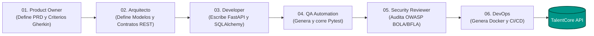

# 🌴 TalentCore API

[](https://fastapi.tiangolo.com/)
[](https://www.python.org/)
[](https://www.docker.com/)
[](https://pytest.org/)
[](https://github.com/features/actions)
[](LICENSE)

> **Microservicio REST desarrollado en FastAPI, SQLAlchemy y SQLite para la gestión ágil de empleados, cálculo dinámico de saldos de vacaciones por antigüedad y flujo de aprobación jerárquico con RBAC.**
> 
> *Este proyecto fue concebido, diseñado, implementado, probado, auditado y contenerizado de forma autónoma mediante una **Fábrica de Software con Agentes de Inteligencia Artificial (SDLC Pipeline)**.*

---

## 📌 ¿De qué trata TalentCore API?

**TalentCore API** es una solución backend ligera y robusta orientada al departamento de Recursos Humanos. Automatiza el ciclo de vida de las solicitudes de vacaciones de los colaboradores de una empresa, asegurando el cumplimiento estricto de las políticas corporativas, la jerarquía organizacional y los límites de días acumulados según la antigüedad laboral.

---

## 🤖 Origen: Desarrollado por Agentes de IA

Este repositorio no fue programado manualmente desde cero. Es el entregable final de un flujo de **6 agentes autónomos de IA** coordinados secuencialmente:



---

## 📋 Reglas de Negocio y Lógica Central

### 1. Control de Acceso Basado en Roles (RBAC)
La API simula la identidad del usuario solicitante mediante la cabecera HTTP `X-User-Id`:

| Rol | Permisos y Capacidades |
| :--- | :--- |
| **`ADMIN_RRHH`** | Exclusivo para dar de alta y registrar nuevos empleados en la base de datos. |
| **`EMPLEADO`** | Consulta su saldo de vacaciones y crea solicitudes de días libres para sí mismo. |
| **`MANAGER`** | Revisa, aprueba o rechaza solicitudes **únicamente de sus subordinados directos** (`empleado.manager_id == manager.id`). Si un manager intenta revisar una solicitud de otro equipo, la API responde `403 Forbidden`. |

### 2. Fórmula de Cálculo de Vacaciones
Los días totales de descanso se asignan dinámicamente en función de los años de antigüedad del empleado en la compañía:
* **Menos de 1 año:** Le corresponden **12 días** base.
* **1 año o más:** Se calcula con la fórmula:
  $$\text{dias\_totales} = \min(12 + 2 \times (\text{anios\_antiguedad} - 1), 20)$$
  *(Tope máximo garantizado de 20 días laborales anuales)*.
* **Saldo Disponible:**
  $$\text{saldo\_disponible} = \text{dias\_totales} - \sum(\text{dias\_solicitados con estado } \texttt{APPROVED})$$

### 3. Máquina de Estados de la Solicitud
* **`PENDING`**: Estado inicial generado por el empleado. Valida que `dias_solicitados <= saldo_disponible`.
* **`APPROVED`**: Aprobada por el Manager directo. Descuenta inmediatamente los días del saldo disponible.
* **`REJECTED`**: Rechazada por el Manager directo. No afecta el saldo de vacaciones.
* *Nota:* Los estados `APPROVED` y `REJECTED` son **terminales**; una solicitud concluida no puede volver a modificarse.

---

## 🛠️ Especificación de Endpoints REST

| Método | Ruta | Cabecera | Código HTTP | Descripción |
| :---: | :--- | :--- | :---: | :--- |
| `GET` | `/health` | *Ninguna* | `200 OK` | Healthcheck para monitoreo y orquestadores. |
| `POST` | `/api/v1/empleados` | `X-User-Id: <id>` *(opcional en el 1er registro)* | `201 Created` / `403 Forbidden` | Crea un empleado. Restringido a usuarios con rol `ADMIN_RRHH`. |
| `GET` | `/api/v1/vacaciones/saldo/{id}` | *Ninguna* | `200 OK` / `404 Not Found` | Obtiene días totales, aprobados y saldo restante. |
| `POST` | `/api/v1/vacaciones/solicitar` | *Ninguna* | `201 Created` / `400 Bad Request` | Radica una nueva solicitud de días en estado `PENDING`. |
| `POST` | `/api/v1/vacaciones/{id}/revisar` | `X-User-Id: <manager_id>` | `200 OK` / `403 Forbidden` | Aprueba (`APPROVE`) o rechaza (`REJECT`) una solicitud. Valida subordinación directa. |

---

## 🗂️ Estructura del Repositorio

```plaintext
talentcore-api/
├── .github/workflows/
│   └── ci.yml              # Pipeline de CI/CD para GitHub Actions
├── app/
│   ├── __init__.py
│   ├── models.py           # Modelos SQLAlchemy 2.0 y Esquemas Pydantic v2
│   └── main.py             # Endpoints FastAPI, RBAC y lógica de negocio
├── tests/
│   ├── __init__.py
│   └── test_api.py         # Suite completa de pruebas con TestClient y Pytest
├── Dockerfile              # Imagen ligera optimizada sobre python:3.11-slim
├── docker-compose.yml      # Manifiesto para despliegue local o en la nube
├── requirements.txt        # Dependencias fijadas del proyecto
├── probar_api.py           # Cliente interactivo E2E para demostración dinámica
└── README.md               # Documentación general del microservicio
```

---

## 🚀 Guía de Instalación y Uso Rápido

### 1. Clonar el repositorio
```bash
git clone https://github.com/AkaSaulb/talentcore-api.git
cd talentcore-api
```

### 2. Opción A: Ejecución Local en Python

#### Crear y activar entorno virtual
```bash
python -m venv venv

# En Windows:
venv\Scripts\activate
# En Linux/macOS:
source venv/bin/activate
```

#### Instalar dependencias
```bash
pip install -r requirements.txt
```

#### Iniciar el servidor FastAPI
```bash
uvicorn app.main:app --reload --port 8000
```

* **Swagger UI interactivo:** [http://127.0.0.1:8000/docs](http://127.0.0.1:8000/docs)
* **ReDoc:** [http://127.0.0.1:8000/redoc](http://127.0.0.1:8000/redoc)

---

### 3. Opción B: Despliegue con Docker Compose
Si tienes Docker instalado, puedes levantar el microservicio con un solo comando:

```bash
docker-compose up --build -d
```
El servicio estará listo y escuchando en el puerto `http://localhost:8000`.

Para detener el contenedor:
```bash
docker-compose down
```

---

## 🧪 Pruebas Automatizadas y Calidad

### Ejecutar pruebas con Pytest
La suite de pruebas cubre todos los criterios de aceptación Gherkin del PRD:
```bash
pytest tests/ -v
```

### Ejecutar simulación E2E interactiva (`probar_api.py`)
Con el servidor corriendo, puedes ejecutar este script en otra terminal para simular el ciclo completo:
1. Creación de Administrador de RRHH.
2. Alta de Manager y Empleado subordinado.
3. Consulta de saldos por antigüedad.
4. Solicitud exitosa de vacaciones.
5. Intento fallido de solicitud por saldo insuficiente (`400 Bad Request`).
6. Intento de aprobación por manager no autorizado (`403 Forbidden`).
7. Aprobación exitosa por el manager directo (`200 OK`).

```bash
python probar_api.py
```

---

## 🛡️ Auditoría de Seguridad (OWASP API Top 10)

El código incorpora medidas preventivas contra riesgos comunes en APIs:
* **API1: Broken Object Level Authorization (BOLA):** Mitigado verificando explícitamente en el backend que el usuario que intenta revisar la solicitud sea el manager directo (`empleado.manager_id == X-User-Id`).
* **API5: Broken Function Level Authorization (BFLA):** Mitigado restringiendo la creación de nuevos usuarios únicamente a roles `ADMIN_RRHH`.
* **Próximas mejoras para producción:** Reemplazo del header plano `X-User-Id` por tokens firmados criptográficamente (**JWT / OAuth2**) e integración de migraciones automáticas de base de datos con **Alembic**.

---

## 📄 Licencia

Este proyecto está bajo la Licencia **MIT**. Consulta el archivo `LICENSE` para más información.
